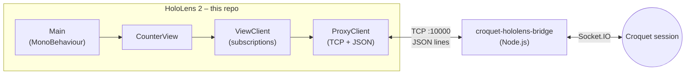

# hololens-croquet-client

A **Unity / MRTK 2** application for **Microsoft HoloLens 2** that shares state with a
**[Croquet](https://croquet.io)** session, so a hologram on the headset can stay in sync
with other Croquet participants (for example, a web app).

Croquet runs in JavaScript, so the headset doesn't talk to it directly: it connects over
TCP to a Node.js bridge, [croquet-hololens-bridge](https://github.com/TonelliLuca/croquet-hololens-bridge),
which forwards messages to and from the Croquet session.

Built for my bachelor's thesis.

> **Context:** this project dates from early 2023, before Croquet released its official
> Unity integration (Croquet for Unity). At the time there was no supported way to run a
> Croquet session from Unity, so this bridge-based approach was built from scratch.

## Architecture

The code mirrors Croquet's own **Model / View** split and its **publish / subscribe**
API, so Unity code can be written the same way you would write a Croquet view in
JavaScript.

| File (`Assets/Scripts/newScript/`) | Role |
| --- | --- |
| `croquet_adapter/AbstractProxyClient.cs` | `ProxyClient`: opens the TCP connection, reads JSON lines on a background thread and dispatches them (`connection-ready`, `ready`, `event`, `data`); sends `join`, `subscribe`, `publish`. |
| `croquet_adapter/ViewClient.cs` | Concrete client: keeps a table of `(scope, event) → handler`, subscribes them when the session is `ready`, and routes incoming events to the right handler. |
| `croquet_adapter/Subscription.cs` | Key of the subscription table (scope + event name). |
| `croquet_adapter/ModelData.cs` | Base class for shared data, with JSON array helpers around Unity's `JsonUtility`. |
| `View.cs` | Abstract view exposing Croquet-style `Subscribe` / `Publish`. |
| `CounterModel.cs` | Example shared model: the position (`cubeX`, `cubeY`, `cubeZ`) of a cube. |
| `CounterView.cs` | Example view: publishes the cube position on scope `cube`, event `sendData`. |
| `Main.cs` | Entry point: finds the `TestCube` object and publishes its position every frame. |

### Connection flow

1. `ProxyClient` connects to the bridge and waits for `connection-ready`.
2. It replies with `join`; the Croquet side answers `ready`.
3. `ViewClient` sends a `subscribe` for each registered handler.
4. From then on, `Publish(...)` sends data to the session and incoming `event` messages
   are passed to the matching handler.

## Tech stack

- Unity **2020.3.37f1**
- Mixed Reality Toolkit **2.8.3**, Mixed Reality OpenXR plugin **1.7.0** (bundled as
  `.tgz` in `Packages/MixedReality`)
- TextMesh Pro
- .NET `TcpClient` for networking

## Running it

1. Start the Croquet session (Socket.IO server on `localhost:3000`) and the
   [bridge](https://github.com/TonelliLuca/croquet-hololens-bridge) on a PC reachable
   from the headset.
2. Open this folder with Unity **2020.3.37f1**.
3. In `croquet_adapter/AbstractProxyClient.cs`, change the bridge address
   (`192.168.40.100`, port `10000`) to the IP of the PC running the bridge.
4. In `Assets/Scenes/SampleScene.unity`, make sure there is a GameObject named
   **`TestCube`** and that the `Main` script is attached to a GameObject in the scene.
   To move the cube by hand on HoloLens, add MRTK's `ObjectManipulator` and
   `NearInteractionGrabbable` to it.
5. Press Play in the editor, or build for **UWP / ARM64** and deploy to the HoloLens 2.

Moving the cube publishes its position to the Croquet session via `cube` / `sendData`.

## Known limitations

This was a thesis prototype: it worked for the demo, but it is not production code.

- The bridge IP address is hard-coded.
- The adapter is tied to `CounterModel` (`View`, `ViewClient` and `Message` use it
  directly) instead of being generic over any model.
- The demo publishes the cube position on every frame, with no throttling or change
  detection.
- Messages are read in 4 KB chunks and split on `\n`, so a message split across two
  reads is lost.
- Incoming events are handled on the background network thread; anything touching
  Unity objects in a handler must be dispatched to the main thread.
- `Subscription.Equals` treats two subscriptions as equal when *either* the scope
  *or* the event name matches.
